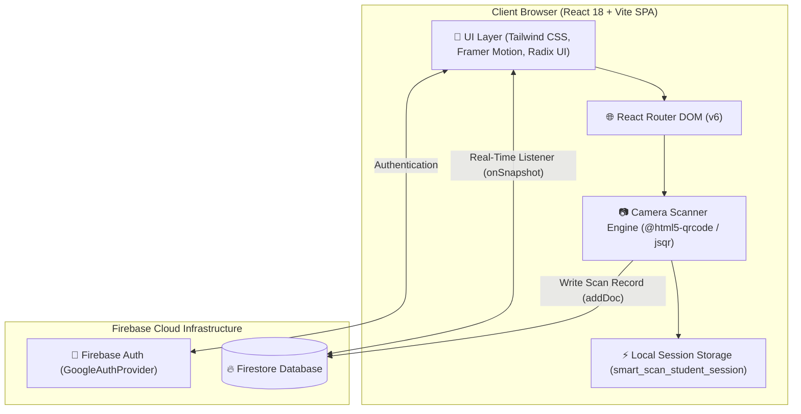
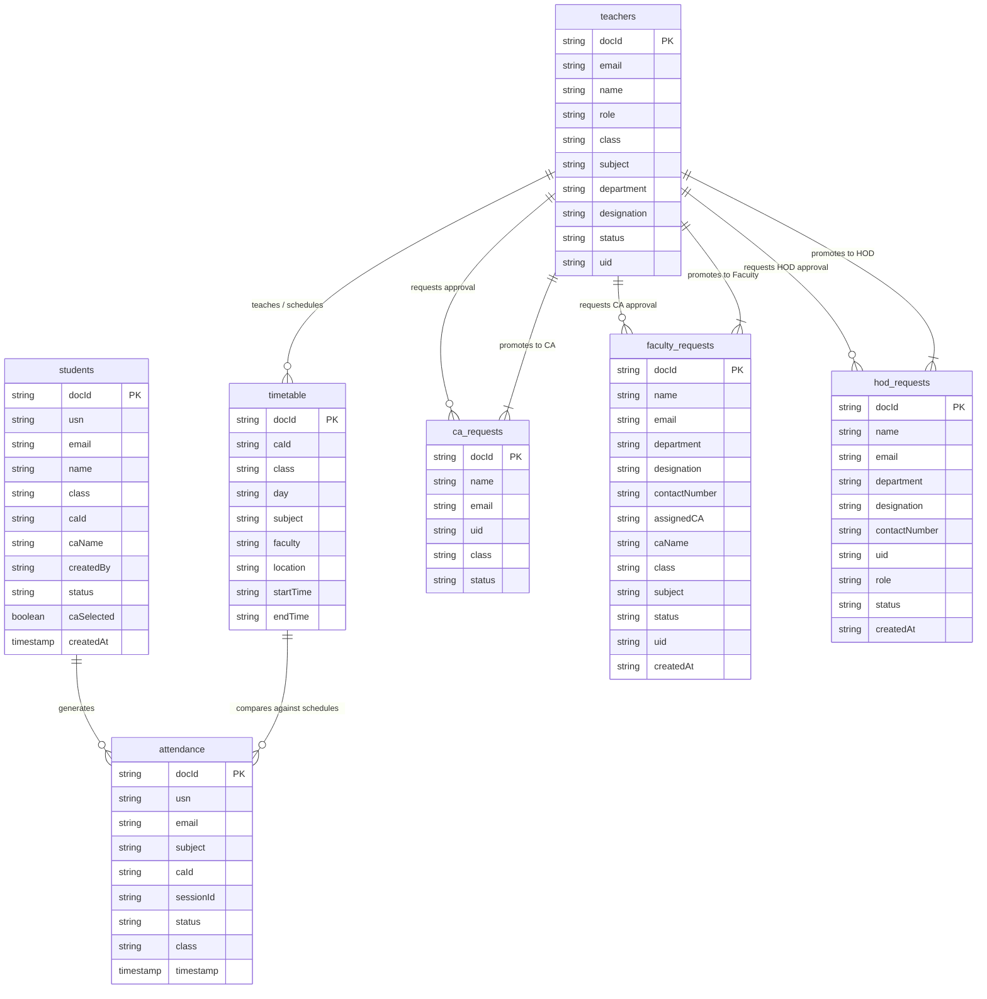

# Technical Architecture — CanAttend

> **CanAttend** is built on a modern, reactive single-page app (SPA) architecture leveraging **React 18**, **TypeScript**, **Vite**, **Tailwind CSS**, and **Firebase Firestore**.

---

## 🏗️ High-Level System Architecture



---

## 🗄️ Database Entity Relationship (ER) Schema



---

## 🌐 Application Route Mapping

Defined in [`src/App.tsx`](file:///e:/Hackathon/Smart%20Attendance/smart-scan-attend/src/App.tsx):

| Route Path | Page Component | Access Scope | Description & Responsibility |
| --- | --- | --- | --- |
| `/` | `Landing` | Public | Institutional homepage and gateway choices |
| `/student-login` | `StudentLogin` | Public / Student | One-time student registration & profile creation |
| `/dashboard` | `Dashboard` | Student | Student home card menu (Scanner & MyTrack) |
| `/scanner` | `Scanner` | Student | Camera QR scanner for logging live presence |
| `/history` | `History` | Student | Student MyTrack schedule & daily attendance metrics |
| `/admin-login` | `AdminLogin` | Public / Admin | Password terminal entry (`admin123`) |
| `/admin-select` | `AdminSelect` | Admin | Executive gateway selector (HOD / CA / Faculty) |
| `/ca-login` | `CALogin` | Public / CA | CA login and privilege request form |
| `/ca` | `CADashboard` | Class Advisor | CA overview dashboard (Roster, Requests, Attendance) |
| `/ca/timetable` | `CATimetable` | Class Advisor | Class schedule manager with HTML time pickers |
| `/faculty-login` | `FacultyLogin` | Public / Faculty | Faculty authentication |
| `/faculty` / `/faculty/subjects` | `FacultySubjects` | Faculty | Course subject selector |
| `/faculty/session/:caId` | `FacultySession` | Faculty | Dynamic QR session generator & verification list |
| `/hod-login` | `HODLogin` | Public / HOD | Dual-option HOD portal: Google OAuth sign-in for approved HODs & New HOD registration form |
| `/hod-dashboard` | `HODDashboard` | Approved HOD | Protected executive terminal for HOD approvals, CA appointments, and staff oversight |
| `*` | `NotFound` | Public | Institutional 404 error page |

---

## 📁 Source Code Structure

```
src/
├── components/          # Reusable UI & Layout Components
│   ├── CollegeLogo.tsx  # Institutional Logo Renderer (/logo.jpeg)
│   └── ui/              # Radix UI / Shadcn primitives (button, card, dialog, etc.)
├── layouts/
│   └── AppLayout.tsx    # Shell wrapper with CanAttend navbar & footer
├── lib/
│   ├── facultyAuth.ts   # Faculty Firebase Authentication & CA approval verification logic
│   ├── hodAuth.ts       # HOD Firebase Authentication & Firestore verification logic
│   ├── studentAuth.ts   # Student CA roster verification & status checks (unregistered, approved, pending, mismatch)
│   └── utils.ts         # Class merging & utility functions
├── pages/               # Page Controllers & Views
│   ├── Landing.tsx      # Split Hero & Gateway selection
│   ├── StudentLogin.tsx # Student registration & session setup
│   ├── Scanner.tsx      # QR Scanner engine & database write
│   ├── History.tsx      # MyTrack daily metrics & class schedule
│   ├── CATimetable.tsx  # Timetable grid editor with time pickers
│   ├── FacultyLogin.tsx # Faculty Google OAuth sign-in & New Faculty Request form
│   ├── FacultySubjects.tsx # Protected teaching subject selection & session launcher
│   ├── FacultyDashboard.tsx # Protected CA selection for attendance session
│   ├── FacultySession.tsx # Live dynamic QR generation & student attendance terminal
│   ├── HODLogin.tsx     # Gmail OAuth login & new HOD registration form
│   ├── HODDashboard.tsx # Protected HOD oversight, CA & HOD approvals
│   └── ...
├── firebase.js          # Firebase Auth & Firestore Initialization
├── App.tsx              # Main Router setup
└── main.tsx             # React DOM entrypoint
```
