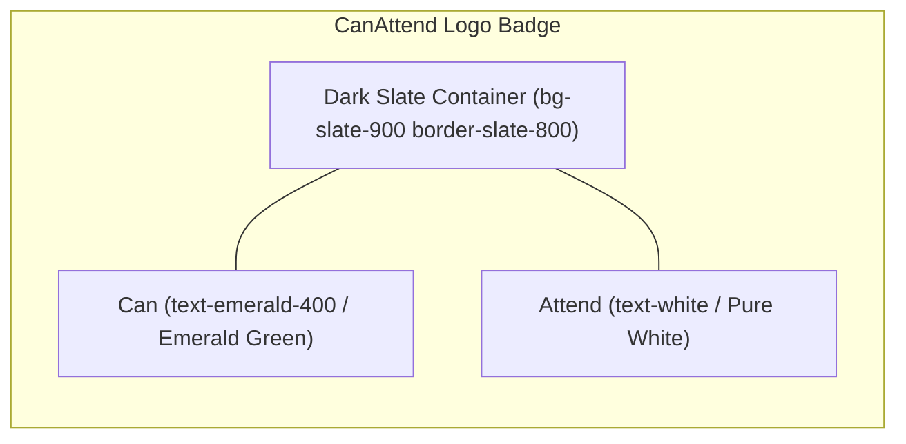
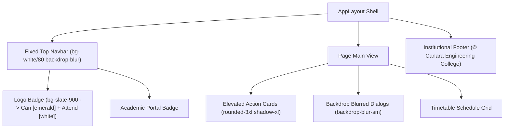

# Design System & UI Documentation — CanAttend

> **CanAttend** features a modern, institutional design system with high-contrast emerald green highlights, slate surfaces, backdrop blurs, smooth Framer Motion transitions, and clean typography.

---

## 🎨 Brand Identity Specs

### Brand Palette Matrix

| Token | Class Name | Visual Usage | Sample Hex / CSS |
| --- | --- | --- | --- |
| **Brand Primary Green** | `text-emerald-400` / `text-emerald-500` / `bg-emerald-600` | `"Can"` text, primary action buttons, active badges, focus rings | `#10b981` / `#059669` |
| **Brand White Text** | `text-white` | `"Attend"` text, dark card text, primary button text | `#ffffff` |
| **Logo Pill Background** | `bg-slate-900` / `border-slate-800` | Header navbar logo container, dark hero card background | `#0f172a` |
| **Light Background** | `bg-slate-50` / `bg-[#f4f7fa]` | Page body background, light panel surfaces | `#f8fafc` / `#f4f7fa` |
| **Card Border** | `border-slate-200/80` | Elevated card outlines, input borders | `#e2e8f0` |

---

## 🖼️ Component Visual Hierarchy

---

## 📐 Core Component Designs

### 1. Landing Page (`Landing.tsx`)
- **Left Panel (~52%)**: Full-height hero with `CEC.jpg` photograph, linear/radial gradient overlays, `CanAttend` header, and institutional slogans.
- **Right Panel (~48%)**: Light `#f4f7fa` surface holding the System Access card with direct links to Student Login and Admin & Faculty Access.

### 2. Navigation Header (`AppLayout.tsx`)
- Fixed top navigation bar: `backdrop-blur-md bg-white/80 border-b border-slate-200/60 shadow-sm`.
- Embedded logo badge: `bg-slate-900 px-3 py-1 rounded-xl border border-slate-800` containing `CanAttend`.

### 3. Status Badges
- **PRESENT**: `bg-emerald-50 text-emerald-700 border-emerald-200`
- **ABSENT**: `bg-rose-50 text-rose-700 border-rose-200`
- **UPCOMING**: `bg-slate-100 text-slate-700 border-slate-200`

### 4. Modals & Forms
- Rounded `rounded-3xl` cards with `shadow-2xl` and backdrop blur `bg-slate-900/40`.
- Native time pickers (`<input type="time" />`) styled with green focus rings (`focus:ring-2 focus:ring-emerald-500/20 focus:border-emerald-500`).
