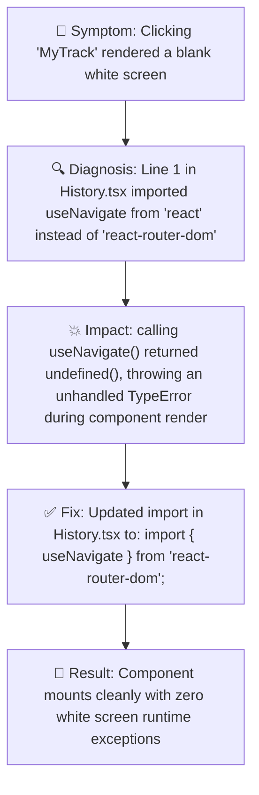

# Project Memory & Key Decisions — CanAttend

> **Persistent Knowledge Base**: This document stores critical architectural decisions, security boundaries, database conventions, and bug solutions that must never be altered or forgotten.

---

## 🧠 Permanent System Truths

> [!IMPORTANT]
> **Source Code = Ultimate Truth**: If documentation ever conflicts with source code implementation, the source code is the truth. Update documentation to match code.

> [!NOTE]
> **Rebranding Policy**: The product name is strictly **CanAttend**. `Can` is emerald green (`text-emerald-400` / `text-emerald-500`) and `Attend` is white (`text-white`) inside a dark slate logo pill (`bg-slate-900`) in navigation headers.

---

## 🔑 Key Architectural & Security Decisions

| Decision Area | Decision Made | Rationale & Impact |
| --- | --- | --- |
| **Product Rebranding** | Rebrand "Smart Attendance" to **CanAttend** | Applied green (`Can`) + white (`Attend`) branding across all pages, footers, headers, and meta tags. Removed Algominds. |
| **Student Roster Authorization** | Students MUST be registered in Firestore `students` roster by an authorized CA | Replaced blind session trust with strict Firestore credential checks (`studentAuth.ts`). Handled Scenario A (unregistered error), Scenario B (approved entry), Scenario C (pending error), and Scenario D (mismatch error). Real-time snapshot kicks out deleted students. |
| **Student Data Scope** | Query Firestore `timetable` by `session.class` and `attendance` by `session.usn` | Guarantees students never see schedules or attendance scans belonging to other classes/sections. |
| **CA Class Scope** | Lock CA Dashboard & Timetable page to CA's profile `class` | Removes class dropdowns; prevents CAs from altering timetables for other sections. |
| **Time Pickers** | Use native HTML `<input type="time" />` in timetable modals | Eliminates manual typing errors and provides intuitive mobile/desktop clock interfaces. |
| **Day Inheritance** | Inherit active day tab in Add Period modal | Eliminates redundant day dropdown selections. |
| **HOD Authentication** | Replaced hardcoded password with Firebase Google Sign-In & Firestore authorization | Replaced `sessionStorage` and `12345` with Firebase OAuth, `hod_requests` with pending approval workflow, and protected `HODDashboard` route. |
| **Faculty Authentication & CA Approval** | Google Auth does not equal faculty access; requires CA approval | Replaced automatic redirection with strict verification in `faculty_requests` and `teachers`. Handles approved, pending, rejected, and unregistered statuses. |
| **Faculty & CA Authorization Alerts** | Reused exact Faculty Authorization Alert design for CA Login | Light pink background (`bg-rose-50`), red border (`border-rose-200`), red warning icon (`AlertCircle`), and bold 'Authorization Alert' heading with distinct unapproved vs unregistered messages. |
| **Student Profile Fetch & Fallback** | Prevent infinite "Loading Student Profile..." screens | Always perform direct `getDoc()` on mount with document ID; add `onSnapshot` error callbacks; safety timeout ends loading state; redirect to CA selection flow if CA missing; pass in-app error to `StudentLogin` if document missing. |
| **Forced Rear Camera for QR Scanning** | Programmatic rear camera activation via `Html5Qrcode` | Force `facingMode: { exact: "environment" }` with `facingMode: "environment"` fallback, and desktop fallback; eliminate camera selection dropdowns and front-camera switches; display in-app alert for denied/unavailable cameras; clean stream stoppage on unmount. |
| **Student Login Approval System** | Mandatory CA authorization on every single login attempt | Every login generates a new `student_login_requests` document with unique `sessionToken`. Student remains on pending screen until CA approves. Signing out invalidates the session token in Firestore. `/dashboard`, `/scanner`, and `/history` verify the active approved request in real-time. Document IDs are used as relationship keys (`studentDocId`, `caId`). |
| **HOD Institutional Oversight & CA Role Separation** | Separation of approval duties: HOD oversees all staff; CA manages students | HOD Dashboard features **Institutional Approval Management** with dedicated cards for CA Requests and Faculty Requests (with live pending badges and expandable review terminals) and **Institutional Staff Directory** with CAs & Faculty (displaying name, email, designation/role, department, assigned class, and dismissal option with an in-app confirmation dialog). CA Dashboard has Faculty Requests card removed, focusing strictly on Student Login Approvals, Class Attendance, Student Roster, and Class Timetable. Dismissal revokes login access without deleting historical attendance logs. |
| **HOD Dashboard Two-Level Navigation Hierarchy** | Clean two-level navigation system for HOD Portal | Main `/hod-dashboard` shows ONLY two large, equal-importance cards: (1) **Institutional Approval Management** (shows pending request count, navigates to `/hod/approval-management`) and (2) **Institutional Staff Directory** (shows total approved staff count, navigates to `/hod/staff-directory`). Both dedicated sub-pages include 'Back to HOD Dashboard' buttons, live search/filtering, and maintain existing Firestore approval and dismissal logic. |
| **Unified Institutional Entry & Registration Flow** | Consistent authentication flow across HOD, CA, and Faculty | Every visit to `/hod-login`, `/ca-login`, or `/faculty-login` presents the mandatory two-option screen: (Option 1) Existing Account – Continue with Google with Firestore role verification; (Option 2) New Account – Create Account with Google authentication binding, saving requests with `pending` status. Dashboards strictly verify role authorization on load. Auto-redirecting on mount is removed to ensure the selection screen is presented on every visit. |
| **HOD-Controlled CA Appointment System** | Removed independent CA self-registration; only HOD appoints approved faculty as CAs | Independent CA registration is completely eliminated (`CALogin` has only Google login for existing CAs; `RequestCA` is retired with redirect). HOD manages appointments at `/hod/ca-appointments` with 3 sections: Select Approved Faculty, Assign Semester/Section (1st-8th, A-D), Confirm Appointment. Uses atomic Firestore batch writes: revokes previous active CA for the class (sets `status: "replaced"`, resets faculty doc `isCA: false`, `caClass: null`), appoints new faculty (creates active `ca_appointments` record, updates faculty doc with `isCA: true`, `role: "ca"`, `caClass`). Replaced CAs retain their faculty account and faculty login access without disruption. Staff Directory displays CA indicators (`CA of 5th C` / `Not Assigned`) with direct reassign/revoke dialogs. CA Dashboard strictly verifies active appointment on load and redirects revoked users immediately. |
| **Active CA Appointment as Single Source of Truth for Student Requests** | Eliminate request routing to stale/previous CAs | When a student submits a login request, the system resolves the currently active appointment from `ca_appointments` (`where("status", "==", "active")`) matching the class section. Student login requests explicitly bind `caAppointmentId` and `assignedFacultyDocId` (Firestore document IDs). Fallbacks to outdated teacher records without active appointments were eliminated from `verifyCAAuthorization`. On CA replacement, all pending login requests for that class are automatically reassigned to the new active CA. When active CA mounts `CAStudentApprovals`, pending requests are healed and scoped strictly to the active appointment. Replaced CAs lose access to CA approval terminals while retaining faculty portal privileges. Firestore security rules prohibit students from approving their own requests. |
| **Student Session Invariant Across Dashboard and Scanner** | Prevent session stripping on Firestore live updates | `StudentSession` retains all session metadata (`id`, `name`, `usn`, `email`, `uid`, `class`, `semester`, `section`, `caId`, `caName`, `caAppointmentId`, `loginRequestId`, `sessionToken`). In `Dashboard.tsx`, the real-time `onSnapshot` listener previously re-saved a partial session that omitted `loginRequestId` and `sessionToken`, wiping them from `localStorage` and causing `Scanner.tsx` to throw an "Authentication Failed" error. Fixed by preserving all session fields in both initial profile fetch and live snapshot updates. Sign-out cleanly invalidates the Firestore request and clears storage, requiring fresh CA approval on the next login attempt. |
| **Canonical Student Authentication & Robust Scanner Validation** | Unified session utility and non-destructive route transition | Centralized the canonical `StudentSession` model, storage helpers (`getStoredStudentSession`, `setStoredStudentSession`, `clearStoredStudentSession`), and `validateStudentSession` directly in `src/lib/studentAuth.ts`. Solved premature session purge on route transitions by ensuring `isMounted` guards on snapshot listeners and authoritative retrieval of `sessionToken` from Firestore approval records (`data.sessionToken`). Added diagnostic logging for session attributes on Scanner mount. Allowed immediate access to `Scanner.tsx` when an approved session exists without prompting for re-login. |

---

## 🛠️ Critical Bug Solution Flowchart

---

## 📌 Things That Must NOT Be Changed

1. **Do NOT break student data isolation**: Never remove `where("class", "==", studentClass)` or `where("usn", "==", session.usn)` queries in [`History.tsx`](file:///e:/Hackathon/Smart%20Attendance/smart-scan-attend/src/pages/History.tsx).
2. **Do NOT re-introduce class selection dropdowns for CAs**: CA timetable management must remain locked to the CA's assigned class profile.
3. **Do NOT use text inputs for time fields**: Keep native HTML `<input type="time" />` for start and end times in timetable modals.
4. **Do NOT revert `useNavigate` import**: Always import `useNavigate` from `"react-router-dom"`.
5. **Do NOT display forbidden names**: Do not display "Smart Attendance", "SmartAttendance", "Smart Scan", "Algominds", or "Algomindes" in visible UI text.
6. **Do NOT trust browser storage as proof of student authorization**: Always validate student sessions against Firestore `students` collection and reject any student not registered/approved in the official CA roster.
7. **Do NOT allow students to bypass CA login approval**: Every login session must possess an active, approved document in `student_login_requests` matched by `sessionToken` and `studentDocId`. Never reuse old approval records.
