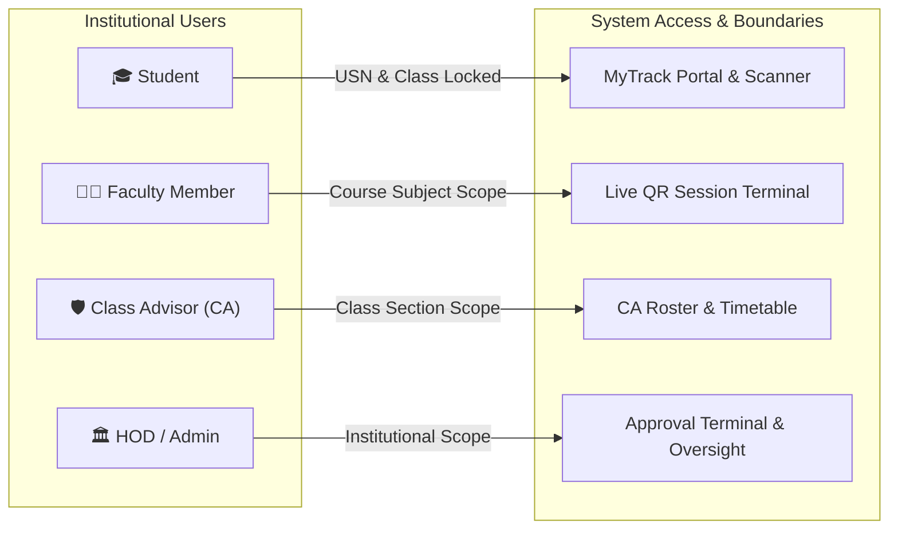
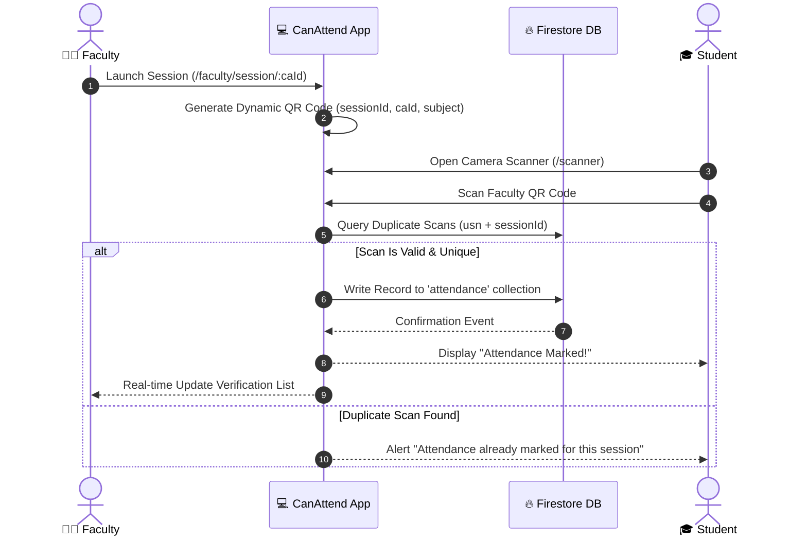
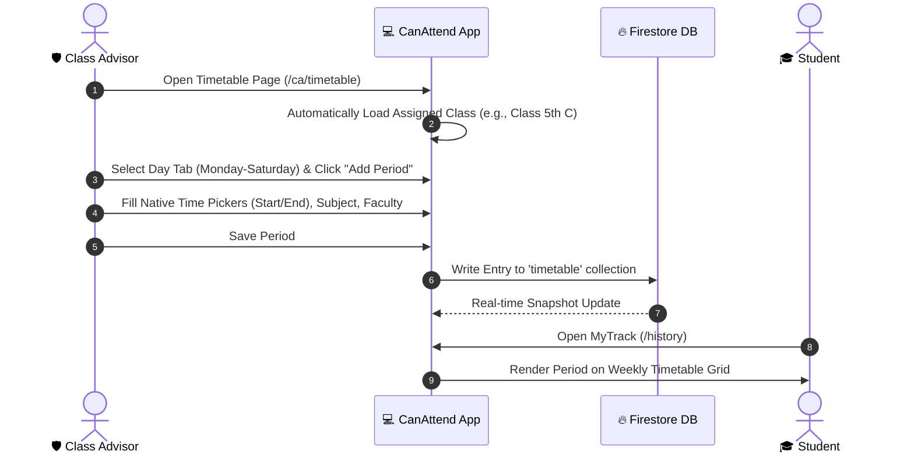

# Product Requirements Document (PRD) — CanAttend

> **CanAttend** is an institutional digital attendance management, dynamic QR code verification, timetable scheduling, and student tracking application engineered specifically for **Canara Engineering College**.

---

## 🚀 Quick Overview

CanAttend replaces manual paper attendance with a secure, real-time dynamic QR scanning system. Faculty members launch live attendance sessions, students scan the QR code via their device cameras, Class Advisors (CAs) manage class timetables and student rosters, and students track their daily schedules and attendance metrics live on MyTrack.

---

## 👥 User Role Architecture

---

## 📋 Role & Feature Capabilities

| Role | Key Features | Primary Routes | Storage / Collection |
| --- | --- | --- | --- |
| **Student** | Google Auth registration, live QR scanner, dynamic daily attendance metrics, class timetable view | `/student-login` `/dashboard` `/scanner` `/history` | `students` `attendance` `timetable` |
| **Faculty** | Google OAuth login, CA approval verification, New Faculty Request form, course selection, launch dynamic QR attendance session, real-time student scan list, manual attendance overrides | `/faculty-login` `/faculty` `/faculty/subjects` `/faculty/dashboard` `/faculty/session/:caId` | `faculty_requests` `teachers` `attendance` |
| **Class Advisor (CA)** | CA login & request submission, faculty request approvals, class student roster, timetable grid management | `/ca-login` `/ca` `/ca/timetable` | `teachers` `ca_requests` `timetable` |
| **HOD / Admin** | Gmail OAuth login, HOD registration with admin approval, approve CA privilege requests, review & approve HOD registrations, institutional staff directory oversight | `/admin-login` `/admin-select` `/hod-login` `/hod-dashboard` | `hod_requests` `ca_requests` `teachers` |

---

## 🔄 Core Workflows

### 1. Dynamic QR Attendance Workflow

### 2. CA Timetable Management Workflow

---

## 🎯 Feature Matrix Details

> [!IMPORTANT]
> **Data Scope Enforcement**: Students only see timetable and attendance data belonging to their registered class section. CAs only manage data belonging to their assigned class section.

### 1. Student MyTrack (`/history`)
- **Daily Attendance Summary**: Calculates **Total Classes**, **Present**, **Absent**, and **Attendance %** dynamically based on the selected day tab (Monday – Saturday).
- **Status Evaluation**:
  - `PRESENT`: Scanned QR attendance record exists in Firestore for that date & subject.
  - `ABSENT`: Scheduled period end time has passed without a matching scan.
  - `UPCOMING`: Scheduled period start/end time is in the future.

### 2. CA Timetable Manager (`/ca/timetable`)
- **Locked Class Assignment**: Automatically derived from CA's logged-in profile. No class selection dropdown.
- **Native HTML Time Pickers**: Modals utilize `<input type="time" />` for start and end times.
- **Inherited Day**: Modal uses the active day tab without asking the user to re-select the day.

### 3. HOD Portal & Google Authentication (`/hod-login` & `/hod-dashboard`)
- **Dual Option Gateway**:
  - **Option 1 (Existing HOD)**: Authenticate with Google; verifies approved HOD status against Firestore (`teachers` with `role: "hod"`, `hod_requests` with `status: "approved"`). Rejects unauthorized or pending accounts.
  - **Option 2 (New HOD Registration)**: Collects Full Name, Official College Gmail, Department, Designation, and Contact Number. Authenticates with Google and creates a record in `hod_requests` with `status: "pending"`.
- **Protected HOD Dashboard Route**: Uses live Firebase Auth state (`onAuthStateChanged`) and Firestore authorization checks (`verifyHODAuthorization`). Completely eliminates hardcoded passwords and `sessionStorage` flags.
- **HOD Self-Management & Oversight**: Approved HODs can review, approve, and dismiss pending HOD registration requests as well as CA appointments.

### 4. Faculty Portal & CA Approval Verification (`/faculty-login`, `/faculty/subjects`, `/faculty/dashboard`)
- **Dual Option Gateway**:
  - **Option A (Existing Faculty)**: Authenticate with Google; verifies CA approval status in Firestore (`faculty_requests` & `teachers`).
    - *Approved*: Allows entry to Teaching Subjects / Dashboard.
    - *Pending*: Blocks access and displays `"Your registration is awaiting CA approval."`.
    - *Rejected*: Blocks access and displays `"Your faculty registration has been rejected. Please contact your Class Advisor."`.
    - *Unregistered*: Blocks access and displays `"Account not found. Please register as a new faculty member."`.
  - **Option B (New Faculty Request)**: Collects Full Name, Official Gmail, Department, Designation, Contact Number, Assigned Class Advisor, and optional teaching subject. Submits request to `faculty_requests` with `status: "pending"`.
- **CA Faculty Approval Workflow**: Assigned Class Advisors review pending faculty requests in `CADashboard.tsx` with one-click **Approve** (updates status to `"approved"`, registers in `teachers`) and **Reject** (updates status to `"rejected"`, revoking access).
- **Protected Faculty Routes**: `/faculty/subjects`, `/faculty/dashboard`, `/faculty/session/:caId`, and `/faculty/add-subject` enforce real-time Firebase Auth and CA approval verification, redirecting unauthorized users.

### 5. Student Portal & CA-Roster Verification (`/student-login`, `/dashboard`, `/scanner`, `/history`)
- **Strict Firestore Roster Enforcement**: Students must be registered in the official `students` roster by an authorized Class Advisor. `localStorage`/`sessionStorage` is never treated as standalone proof of authorization without real-time Firestore verification.
- **Four Strict Authentication Scenarios**:
  - **Scenario A (Unregistered)**: Student entered Gmail/USN not found in CA roster $\rightarrow$ Denied with: `"Your student record has not been registered by your Class Advisor yet. Please contact your CA."`.
  - **Scenario B (Registered & Approved)**: Credentials match an approved student record in CA roster $\rightarrow$ Grants access to Student Dashboard.
  - **Scenario C (Pending)**: Student record has `status: "pending"` $\rightarrow$ Denied with: `"Your student registration is awaiting approval by your Class Advisor."`.
  - **Scenario D (Mismatch)**: Gmail and USN mismatch $\rightarrow$ Denied with: `"The entered Gmail address and USN do not match our registered records. Please verify your details or contact your Class Advisor."`.
- **Real-time Session Verification & Immediate Invalidation**:
  - All protected student routes (`/dashboard`, `/scanner`, `/history`) listen to `students` document in Firestore via `onSnapshot`.
  - If a student profile is deleted by the CA from `CADashboard.tsx`, or if status changes to pending/rejected, the session is wiped immediately and the student is kicked out to `/student-login`.
- **Sign Out Security**:
  - Full wipe of browser storage (`clearStoredStudentSession()`) and Firebase Auth sign-out, preventing back-button access without re-verification.
