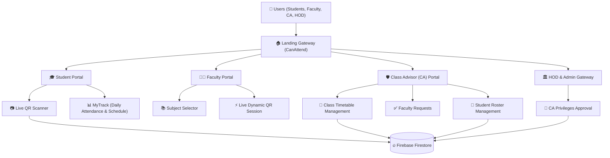

# CanAttend — Project Documentation

> **CanAttend** is a modern, institutional attendance management, dynamic QR scanning, timetable, and student tracking system engineered for **Canara Engineering College**.

---

## 🗺️ Visual Architecture & Flow

---

## 📚 Documentation Index

| Document | Purpose | Main Content |
| --- | --- | --- |
| 📋 **[PRD.md](file:///e:/Hackathon/Smart%20Attendance/smart-scan-attend/docs/PRD.md)** | **Product Requirements** | User roles, workflows, attendance scanning, MyTrack, and timetable specifications. |
| 🏗️ **[ARCHITECTURE.md](file:///e:/Hackathon/Smart%20Attendance/smart-scan-attend/docs/ARCHITECTURE.md)** | **Technical Architecture** | React + Vite + TypeScript stack, router table, Firestore ER schema, and directory layout. |
| 🛑 **[RULES.md](file:///e:/Hackathon/Smart%20Attendance/smart-scan-attend/docs/RULES.md)** | **Development Rules** | Mandatory coding standards, security scopes, data isolation, and branding rules. |
| 🎨 **[DESIGN.md](file:///e:/Hackathon/Smart%20Attendance/smart-scan-attend/docs/DESIGN.md)** | **UI/UX Design System** | Brand color specs (`Can` = green, `Attend` = white), typography, cards, modals, and timetable grids. |
| 🎯 **[TASKS.md](file:///e:/Hackathon/Smart%20Attendance/smart-scan-attend/docs/TASKS.md)** | **Task & Feature Tracker** | Live status across Completed, In Progress, Pending, Future Roadmap, and Known Issues. |
| 🧠 **[MEMORY.md](file:///e:/Hackathon/Smart%20Attendance/smart-scan-attend/docs/MEMORY.md)** | **Project Memory Bank** | Historical decisions, critical bug fixes, security boundaries, and permanent system truths. |

---

## ⚡ Tech Stack Quick Reference

- **Frontend**: React 18 • TypeScript • Vite • Tailwind CSS • Framer Motion
- **UI Components**: Radix UI • Lucide Icons • Shadcn UI Patterns
- **Database & Auth**: Firebase Auth (Google Provider) • Firestore Database
- **Scanning Engine**: `@html5-qrcode` / `jsqr`
