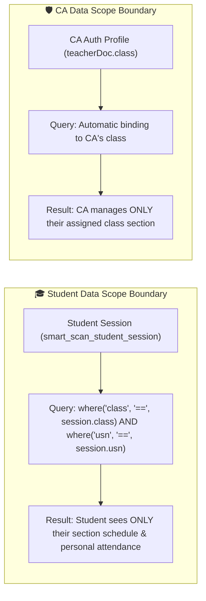
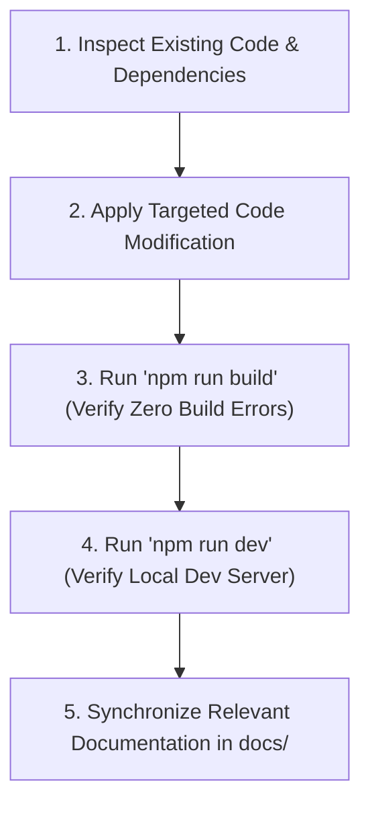

# Development Rules & Coding Standards — CanAttend

> **Mandatory Guidelines**: All developers and AI agents contributing to **CanAttend** must strictly follow these rules. Never break working features or alter data relationships without explicit instruction.

---

## 🛡️ Data Scope & Security Boundaries

---

## ⚠️ Core Development Rules

> [!IMPORTANT]
> **Source Code = Ultimate Truth**: Always inspect authoritative source code using file viewing tools before making diagnostic claims. Never guess imports, schema keys, or route paths.

> [!WARNING]
> **No Superficial Symptom Patches**: Do NOT wrap failing code in silent try/except blocks, swallow exceptions, or return dummy fallback data. Trace and resolve the actual root cause.

> [!CAUTION]
> **Mandatory Verification**: Never claim a task is completed without running `npm run build` (0 compilation errors) and starting `npm run dev` to verify dev server execution.

---

## 📏 Specific Constraints Matrix

| Category | Constraint / Rule | Correct Pattern | Incorrect Pattern |
| --- | --- | --- | --- |
| **Branding** | Website Name | **CanAttend** | Smart Attendance, SmartAttendance, Algominds |
| **Brand Color** | Name Styling | `CanAttend` | Plain unstyled text or altered theme colors |
| **Navigation** | React Router Import | `import { useNavigate } from "react-router-dom";` | `import { useNavigate } from "react";` ❌ (Crashes runtime) |
| **Time Inputs** | Timetable Modals | `<input type="time" />` | Generic `<input type="text" />` requiring manual typing |
| **Day Selection** | Timetable Modals | Inherit active day tab automatically | Displaying duplicate day dropdown inside modal |
| **CA Scope** | Class Assignment | Automatically bound to CA's class profile | Class selection dropdown allowing CA to switch classes |
| **HOD Auth** | Department Head Login | Firebase Google Sign-In with Firestore role verification | Hardcoded passwords or `sessionStorage` authentication flags |
| **Faculty Auth** | Faculty Terminal Login | Google Sign-In with mandatory CA approval verification in Firestore | Redirecting to dashboard immediately upon Google OAuth success |
| **Student Auth** | Student Login & Session | Strict CA roster verification in Firestore (`students` collection) with real-time route listeners | Trusting `localStorage`/`sessionStorage` without validating against Firestore or permitting unregistered students |
| **Student Profile Loading** | Dashboard Profile Fetch | Immediate `getDoc()` fetch with error callbacks and safety timeout to guarantee loading state ends | Relying solely on `onSnapshot()` without fallback, causing infinite "Loading Student Profile..." screens |
| **UI Alerts** | Authorization Notifications | In-app authorization alert banner (`bg-rose-50 border-rose-200 text-rose-800` with `AlertCircle`) matching Faculty Terminal | Native browser alerts `window.alert()`, `window.confirm()`, or unformatted popups |
| **QR Code Scanner** | Camera Mode & Controls | Auto-start rear camera with programmatic `Html5Qrcode` (`facingMode: { exact: "environment" }` $\to$ loose fallback $\to$ desktop fallback); zero camera select UI dropdowns; clean stream termination on unmount | Using `Html5QrcodeScanner` UI wrapper with camera selection dropdowns or defaulting to front/selfie camera |
| **Student Login Approvals** | Approval on Every Login | Fresh `student_login_requests` doc with unique `sessionToken` on every login; in-app pending screen; real-time CA approval; end session on logout; strict route verification in `/dashboard`, `/scanner`, `/history` | Trusting previous approvals, reusing old session tokens, skipping CA approval, or using frontend-only checks |
| **Institutional Staff & Approvals** | HOD & CA Role Separation | HOD exclusively manages **Institutional Approval Management** (two dedicated cards: CA Requests & Faculty Requests) and **Institutional Staff Directory** (with search, role filters, and in-app dismissal confirmation dialog). CA manages only student rosters, student login approvals, class attendance, and class timetable. | Allowing CA to approve/reject faculty, using `window.confirm()` or browser alerts for staff dismissal, or deleting historical attendance records on staff dismissal |
| **HOD Dashboard Navigation** | Two-Level Navigation System | Main `/hod-dashboard` shows ONLY two large, equal-importance clickable cards: Institutional Approval Management (navigating to `/hod/approval-management`) and Institutional Staff Directory (navigating to `/hod/staff-directory`). Both sub-pages feature 'Back to HOD Dashboard' buttons. | Rendering full approval request lists or staff roster directly on the main HOD dashboard, cluttering the top-level view |
| **Mandatory Entry Screens** | Unified Two-Option Authentication | For all three roles (HOD, CA, Faculty), entering `/hod-login`, `/ca-login`, or `/faculty-login` MUST ALWAYS present the dedicated two-option screen (Existing: Continue with Google, New: Create Account) without auto-redirecting. New registrations require Google authentication binding and save with `pending` status. Dashboards strictly verify role clearance on mount. | Auto-redirecting on mount using `onAuthStateChanged`, treating Google login alone as authorization, or allowing unapproved accounts access |
| **CA Appointment** | Class Advisor Appointment & Scope | Only HOD can appoint CAs from existing approved faculty via `/hod/ca-appointments`. Atomic replacement via batch write updates `ca_appointments` & `teachers`. Replaced/retired CAs retain their faculty account and faculty portal access. Never two active CAs per class. | Permitting independent CA self-registration, deleting faculty account when CA appointment is revoked, allowing multiple active CAs for the same class, or using manual non-atomic updates |
| **Login Request Routing** | Single Source of Truth for CA Assignment | Student login approval requests MUST resolve active appointment from HOD `ca_appointments` in Firestore. Requests store `caAppointmentId` and `assignedFacultyDocId`. On CA replacement, pending requests are automatically reassigned to the new CA. Students cannot approve their own requests. | Routing requests using student document's stale `caId`/`createdBy` fields, trusting old teacher records with outdated CA flags, or allowing previous CAs to approve requests after appointment replacement |
| **Student Session Persistence** | Storage Across Dashboard, Scanner, and History | `StudentSession` MUST preserve all verified fields (`id`, `name`, `usn`, `email`, `uid`, `class`, `semester`, `section`, `caId`, `caName`, `caAppointmentId`, `loginRequestId`, `sessionToken`) across initial loads, real-time snapshot listeners, page refreshes, and navigation. | Constructing partial session objects on snapshot updates that drop `loginRequestId` or `sessionToken`, causing `Scanner` or `History` to trigger false authentication failures |

---

## 🔄 Standard Change Workflow

