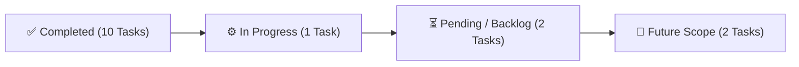

# Project Task Tracker & Roadmap — CanAttend

> **Current Project Status**: All core features, rebranding tasks, timetable improvements, student data isolation rules, and documentation systems are fully implemented and verified.

---

## 📊 Task Status Summary

---

## ✅ Completed Tasks

| Task Description | Target File / Area | Verification Status |
| --- | --- | --- |
| **Website Rebranding to CanAttend** | [`index.html`](file:///e:/Hackathon/Smart%20Attendance/smart-scan-attend/index.html) [`AppLayout.tsx`](file:///e:/Hackathon/Smart%20Attendance/smart-scan-attend/src/layouts/AppLayout.tsx) [`Landing.tsx`](file:///e:/Hackathon/Smart%20Attendance/smart-scan-attend/src/pages/Landing.tsx) | ✅ Verified (`Can` = green, `Attend` = white, Algominds removed) |
| **Fix MyTrack White Screen Crash** | [`History.tsx`](file:///e:/Hackathon/Smart%20Attendance/smart-scan-attend/src/pages/History.tsx) | ✅ Verified (Fixed `useNavigate` import from `"react-router-dom"`) |
| **Strict Student Class Section & USN Filtering** | [`History.tsx`](file:///e:/Hackathon/Smart%20Attendance/smart-scan-attend/src/pages/History.tsx) | ✅ Verified (Queries filtered by `session.class` & `session.usn`) |
| **Dynamic Daily Attendance Overview** | [`History.tsx`](file:///e:/Hackathon/Smart%20Attendance/smart-scan-attend/src/pages/History.tsx) | ✅ Verified (Recalculates Total, Present, Absent, % per day tab) |
| **Remove Section C Attendance History Logs** | [`History.tsx`](file:///e:/Hackathon/Smart%20Attendance/smart-scan-attend/src/pages/History.tsx) | ✅ Verified (Historical table section completely removed) |
| **CA Timetable Class Locking** | [`CATimetable.tsx`](file:///e:/Hackathon/Smart%20Attendance/smart-scan-attend/src/pages/CATimetable.tsx) | ✅ Verified (Dropdown removed; auto-bound to CA's class) |
| **Remove Duplicate Day Selection Dropdown** | [`CATimetable.tsx`](file:///e:/Hackathon/Smart%20Attendance/smart-scan-attend/src/pages/CATimetable.tsx) | ✅ Verified (Modal inherits selected day tab automatically) |
| **Native HTML Time Picker Integration** | [`CATimetable.tsx`](file:///e:/Hackathon/Smart%20Attendance/smart-scan-attend/src/pages/CATimetable.tsx) | ✅ Verified (Start/End times use `<input type="time" />`) |
| **Timetable Weekly Grid Layout** | [`CATimetable.tsx`](file:///e:/Hackathon/Smart%20Attendance/smart-scan-attend/src/pages/CATimetable.tsx) | ✅ Verified (Structured grid view with periods) |
| **Visual Documentation System Setup** | `docs/` folder | ✅ Verified (`README.md`, `PRD.md`, `ARCHITECTURE.md`, `RULES.md`, `DESIGN.md`, `TASKS.md`, `MEMORY.md`) |
| **Replace HOD Password Login with Firebase Gmail Auth** | [`HODLogin.tsx`](file:///e:/Hackathon/Smart%20Attendance/smart-scan-attend/src/pages/HODLogin.tsx) [`HODDashboard.tsx`](file:///e:/Hackathon/Smart%20Attendance/smart-scan-attend/src/pages/HODDashboard.tsx) [`hodAuth.ts`](file:///e:/Hackathon/Smart%20Attendance/smart-scan-attend/src/lib/hodAuth.ts) | ✅ Verified (Google OAuth, approval checks, HOD registration form with pending status, protected dashboard route) |
| **Fix Faculty Google Auth & CA Approval Verification** | [`FacultyLogin.tsx`](file:///e:/Hackathon/Smart%20Attendance/smart-scan-attend/src/pages/FacultyLogin.tsx) [`CADashboard.tsx`](file:///e:/Hackathon/Smart%20Attendance/smart-scan-attend/src/pages/CADashboard.tsx) [`facultyAuth.ts`](file:///e:/Hackathon/Smart%20Attendance/smart-scan-attend/src/lib/facultyAuth.ts) Faculty routes | ✅ Verified (Google OAuth, CA approval verification, New Faculty Request with pending status, Approve/Reject CA actions, protected faculty routes) |
| **Enforce CA-Registered Student Records for Student Login** | [`StudentLogin.tsx`](file:///e:/Hackathon/Smart%20Attendance/smart-scan-attend/src/pages/StudentLogin.tsx) [`studentAuth.ts`](file:///e:/Hackathon/Smart%20Attendance/smart-scan-attend/src/lib/studentAuth.ts) [`Dashboard.tsx`](file:///e:/Hackathon/Smart%20Attendance/smart-scan-attend/src/pages/Dashboard.tsx) [`CADashboard.tsx`](file:///e:/Hackathon/Smart%20Attendance/smart-scan-attend/src/pages/CADashboard.tsx) [`History.tsx`](file:///e:/Hackathon/Smart%20Attendance/smart-scan-attend/src/pages/History.tsx) [`Scanner.tsx`](file:///e:/Hackathon/Smart%20Attendance/smart-scan-attend/src/pages/Scanner.tsx) | ✅ Verified (Strict Firestore roster checks for Gmail + USN, Scenario A/B/C/D error handling, zero local storage bypass, real-time kick-out on CA deletion) |
| **Match CA Login Authorization Alert to Faculty Page Design** | [`CALogin.tsx`](file:///e:/Hackathon/Smart%20Attendance/smart-scan-attend/src/pages/CALogin.tsx) [`FacultyLogin.tsx`](file:///e:/Hackathon/Smart%20Attendance/smart-scan-attend/src/pages/FacultyLogin.tsx) | ✅ Verified (Reused exact Faculty Authorization Alert component: `bg-rose-50`, `border-rose-200`, red warning icon, bold 'Authorization Alert' heading, unregistered vs unapproved messages; zero browser alerts/toasts) |
| **Fix Student Dashboard Stuck on Loading Profile** | [`Dashboard.tsx`](file:///e:/Hackathon/Smart%20Attendance/smart-scan-attend/src/pages/Dashboard.tsx) [`StudentLogin.tsx`](file:///e:/Hackathon/Smart%20Attendance/smart-scan-attend/src/pages/StudentLogin.tsx) [`History.tsx`](file:///e:/Hackathon/Smart%20Attendance/smart-scan-attend/src/pages/History.tsx) [`Scanner.tsx`](file:///e:/Hackathon/Smart%20Attendance/smart-scan-attend/src/pages/Scanner.tsx) | ✅ Verified (Direct `getDoc()` fetch with document ID, `onSnapshot` error handling, safety timeout preventing infinite loading, proper redirect with in-app error message when document missing, CA selection flow fallback) |
| **Force Rear Camera for QR Scanning** | [`Scanner.tsx`](file:///e:/Hackathon/Smart%20Attendance/smart-scan-attend/src/pages/Scanner.tsx) | ✅ Verified (Replaced `Html5QrcodeScanner` with programmatic `Html5Qrcode`, forced `facingMode: { exact: "environment" }` $\to$ `facingMode: "environment"` $\to$ desktop fallback, removed camera switch dropdowns, in-app error alerts for denied/unavailable cameras, and clean stream termination on unmount/capture) |
| **Student Login Approval System** | [`StudentLogin.tsx`](file:///e:/Hackathon/Smart%20Attendance/smart-scan-attend/src/pages/StudentLogin.tsx) [`CADashboard.tsx`](file:///e:/Hackathon/Smart%20Attendance/smart-scan-attend/src/pages/CADashboard.tsx) [`CAStudentApprovals.tsx`](file:///e:/Hackathon/Smart%20Attendance/smart-scan-attend/src/pages/CAStudentApprovals.tsx) [`studentAuth.ts`](file:///e:/Hackathon/Smart%20Attendance/smart-scan-attend/src/lib/studentAuth.ts) [`Dashboard.tsx`](file:///e:/Hackathon/Smart%20Attendance/smart-scan-attend/src/pages/Dashboard.tsx) [`firestore.rules`](file:///e:/Hackathon/Smart%20Attendance/smart-scan-attend/firestore.rules) | ✅ Verified (Mandatory approval on every login attempt, unique `student_login_requests` with session tokens, in-app pending approval screen with live onSnapshot listener, dedicated CA Student Approvals terminal with pending counter, route protection on all student endpoints, and Firestore security rules) |
| **HOD & CA Dashboard Restructuring** | [`HODDashboard.tsx`](file:///e:/Hackathon/Smart%20Attendance/smart-scan-attend/src/pages/HODDashboard.tsx) [`CADashboard.tsx`](file:///e:/Hackathon/Smart%20Attendance/smart-scan-attend/src/pages/CADashboard.tsx) [`firestore.rules`](file:///e:/Hackathon/Smart%20Attendance/smart-scan-attend/firestore.rules) | ✅ Verified (Created dedicated **Institutional Approval Management** with CA Requests & Faculty Requests cards and pending badges; created **Institutional Staff Directory** with CAs & Faculty, search, filtering, and in-app dismissal confirmation dialog; removed faculty request management from CA Dashboard) |
| **HOD Dashboard Two-Level Navigation** | [`HODDashboard.tsx`](file:///e:/Hackathon/Smart%20Attendance/smart-scan-attend/src/pages/HODDashboard.tsx) [`HODApprovalManagement.tsx`](file:///e:/Hackathon/Smart%20Attendance/smart-scan-attend/src/pages/HODApprovalManagement.tsx) [`HODStaffDirectory.tsx`](file:///e:/Hackathon/Smart%20Attendance/smart-scan-attend/src/pages/HODStaffDirectory.tsx) [`App.tsx`](file:///e:/Hackathon/Smart%20Attendance/smart-scan-attend/src/App.tsx) | ✅ Verified (Main HOD Dashboard displays ONLY two large, equal-importance cards with live counts and hover effects: Institutional Approval Management and Institutional Staff Directory; moved full details to dedicated sub-pages with 'Back to HOD Dashboard' buttons) |
| **Unified Role-Based Login & Registration Flow** | [`HODLogin.tsx`](file:///e:/Hackathon/Smart%20Attendance/smart-scan-attend/src/pages/HODLogin.tsx) [`CALogin.tsx`](file:///e:/Hackathon/Smart%20Attendance/smart-scan-attend/src/pages/CALogin.tsx) [`FacultyLogin.tsx`](file:///e:/Hackathon/Smart%20Attendance/smart-scan-attend/src/pages/FacultyLogin.tsx) [`caAuth.ts`](file:///e:/Hackathon/Smart%20Attendance/smart-scan-attend/src/lib/caAuth.ts) [`hodAuth.ts`](file:///e:/Hackathon/Smart%20Attendance/smart-scan-attend/src/lib/hodAuth.ts) [`facultyAuth.ts`](file:///e:/Hackathon/Smart%20Attendance/smart-scan-attend/src/lib/facultyAuth.ts) [`CADashboard.tsx`](file:///e:/Hackathon/Smart%20Attendance/smart-scan-attend/src/pages/CADashboard.tsx) | ✅ Verified (Mandatory two-option entry screen appears EVERY TIME across HOD, CA, and Faculty portals; Option 1: Existing Account - Continue with Google with Firestore role verification; Option 2: New Account - Create Account with Google binding and pending status; no auto-redirects; strict dashboard route protections and logout handlers) |
| **HOD-Controlled CA Appointment System** | [`CALogin.tsx`](file:///e:/Hackathon/Smart%20Attendance/smart-scan-attend/src/pages/CALogin.tsx) [`RequestCA.tsx`](file:///e:/Hackathon/Smart%20Attendance/smart-scan-attend/src/pages/RequestCA.tsx) [`HODCAAppointments.tsx`](file:///e:/Hackathon/Smart%20Attendance/smart-scan-attend/src/pages/HODCAAppointments.tsx) [`HODStaffDirectory.tsx`](file:///e:/Hackathon/Smart%20Attendance/smart-scan-attend/src/pages/HODStaffDirectory.tsx) [`HODDashboard.tsx`](file:///e:/Hackathon/Smart%20Attendance/smart-scan-attend/src/pages/HODDashboard.tsx) [`caAuth.ts`](file:///e:/Hackathon/Smart%20Attendance/smart-scan-attend/src/lib/caAuth.ts) [`facultyAuth.ts`](file:///e:/Hackathon/Smart%20Attendance/smart-scan-attend/src/lib/facultyAuth.ts) [`App.tsx`](file:///e:/Hackathon/Smart%20Attendance/smart-scan-attend/src/App.tsx) [`firestore.rules`](file:///e:/Hackathon/Smart%20Attendance/smart-scan-attend/firestore.rules) | ✅ Verified (Removed independent CA registration and request forms; HOD exclusively appoints CAs from approved faculty; atomic replacement of previous CA via batch write; retired CA retains faculty account & access; active appointment validation in CA Dashboard; Staff Directory CA indicators with reassignment & revocation dialogs; firestore rules & build verified) |
| **Fix Student Login Requests Routing to Active CA Appointment** | [`StudentLogin.tsx`](file:///e:/Hackathon/Smart%20Attendance/smart-scan-attend/src/pages/StudentLogin.tsx) [`caAuth.ts`](file:///e:/Hackathon/Smart%20Attendance/smart-scan-attend/src/lib/caAuth.ts) [`studentAuth.ts`](file:///e:/Hackathon/Smart%20Attendance/smart-scan-attend/src/lib/studentAuth.ts) [`CAStudentApprovals.tsx`](file:///e:/Hackathon/Smart%20Attendance/smart-scan-attend/src/pages/CAStudentApprovals.tsx) [`CADashboard.tsx`](file:///e:/Hackathon/Smart%20Attendance/smart-scan-attend/src/pages/CADashboard.tsx) [`firestore.rules`](file:///e:/Hackathon/Smart%20Attendance/smart-scan-attend/firestore.rules) | ✅ Verified (HOD active appointment is single source of truth; requests store `caAppointmentId` & `assignedFacultyDocId`; automatic reassignment of pending requests on CA replacement; removed stale teacher fallbacks; CA Approvals scoped to active appointment; students cannot self-approve; build 0 errors) |
| **Fix Student Dashboard to Scanner Session Preservation** | [`Dashboard.tsx`](file:///e:/Hackathon/Smart%20Attendance/smart-scan-attend/src/pages/Dashboard.tsx) [`Scanner.tsx`](file:///e:/Hackathon/Smart%20Attendance/smart-scan-attend/src/pages/Scanner.tsx) [`StudentLogin.tsx`](file:///e:/Hackathon/Smart%20Attendance/smart-scan-attend/src/pages/StudentLogin.tsx) [`studentAuth.ts`](file:///e:/Hackathon/Smart%20Attendance/smart-scan-attend/src/lib/studentAuth.ts) | ✅ Verified (Preserved `loginRequestId`, `sessionToken`, `uid`, `semester`, `section`, and `caAppointmentId` on both initial load and live Firestore snapshot updates in `Dashboard.tsx`; seamless transition from Dashboard to Scanner without re-authentication; preserved sign-out invalidation; build 0 errors) |
| **Standardize Student Session Model & Fix Scanner Access Check** | [`studentAuth.ts`](file:///e:/Hackathon/Smart%20Attendance/smart-scan-attend/src/lib/studentAuth.ts) [`Scanner.tsx`](file:///e:/Hackathon/Smart%20Attendance/smart-scan-attend/src/pages/Scanner.tsx) [`Dashboard.tsx`](file:///e:/Hackathon/Smart%20Attendance/smart-scan-attend/src/pages/Dashboard.tsx) [`StudentLogin.tsx`](file:///e:/Hackathon/Smart%20Attendance/smart-scan-attend/src/pages/StudentLogin.tsx) [`History.tsx`](file:///e:/Hackathon/Smart%20Attendance/smart-scan-attend/src/pages/History.tsx) | ✅ Verified (Centralized canonical `StudentSession` and storage methods in `studentAuth.ts`; eliminated destructive clearing on component remount; added diagnostic logging; ensured session survival on page refresh and route transition; verified CA approval revocation listeners; 0 build errors) |

---

## ⚙️ In Progress & Pending Tasks

| Task | Status | Priority | Description |
| --- | --- | --- | --- |
| **Continuous Liveness Monitoring** | ⚙️ In Progress | High | Running local dev server (`npm run dev`) and verifying zero console/build errors |
| **Multi-Device Scanner Testing** | ⏳ Pending | Medium | Cross-browser testing for camera QR scanning across iOS & Android devices |
| **Monthly Attendance Export** | ⏳ Pending | Low | CSV/PDF export for CA and HOD attendance records |

---

## 🚀 Future Improvements

- 🔔 **Automated Class Reminders**: Web Push notifications before period start times.
- 📶 **Offline Scan Queue**: Cache student QR scans locally when internet connection drops.

---

## 🐛 Bugs & Resolved Issues

| Issue ID | Description | Resolution | Status |
| --- | --- | --- | --- |
| **BUG-001** | MyTrack page rendered blank white screen upon card click | Corrected `useNavigate` import in `History.tsx` to `"react-router-dom"` | ✅ Resolved |
| **BUG-002** | Student MyTrack displayed timetable periods from other classes | Added strict Firestore query `where("class", "==", studentClass)` | ✅ Resolved |
| **BUG-003** | CA Timetable allowed manual class switching via dropdown | Removed dropdown and locked class to CA profile (`teacherDoc.class`) | ✅ Resolved |
| **BUG-004** | Student Login allowed access without CA registration due to browser session caching | Implemented `studentAuth.ts` with strict Firestore queries, Scenario A-D checks, and real-time Firestore session validation | ✅ Resolved |
| **BUG-005** | Student Portal stuck on "Loading Student Profile..." on Render deployment | Replaced snapshot-only listener with immediate `getDoc()` by document ID, added error callbacks, safety timeout, and in-app error redirect | ✅ Resolved |
| **BUG-006** | Student login approval requests routed to replaced CA (Sharayu) instead of newly appointed CA (Suhu) | Established HOD active `ca_appointments` as single source of truth; requests bind `caAppointmentId` & `assignedFacultyDocId`; automatic reassignment of pending requests during CA replacement and on CA Approvals load; removed old teacher fallback | ✅ Resolved |
| **BUG-007** | Scanner displayed "Authentication Failed" error after student approval because Dashboard stripped session tokens on snapshot update | Fixed `Dashboard.tsx` real-time snapshot listener to retain `loginRequestId`, `sessionToken`, `uid`, `semester`, `section`, and `caAppointmentId`; unified session schema across StudentLogin, Dashboard, and Scanner | ✅ Resolved |
